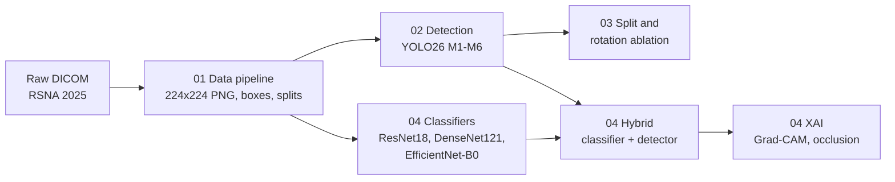
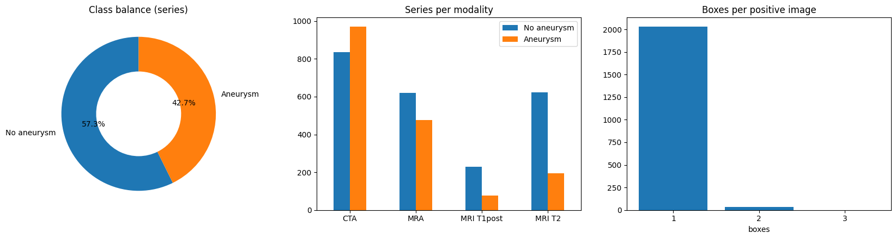
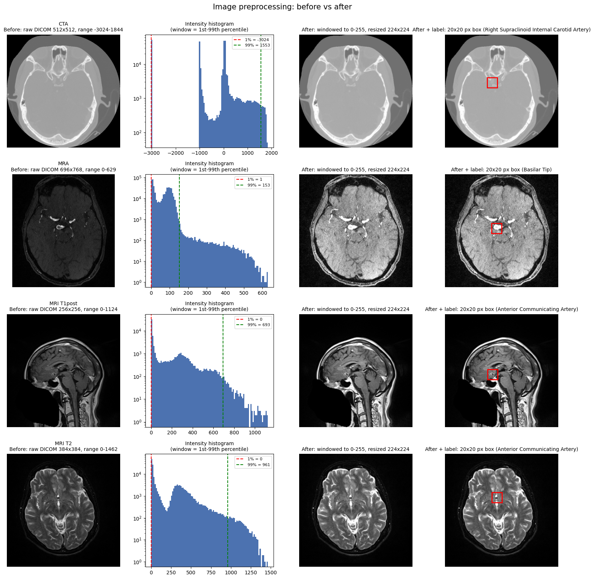
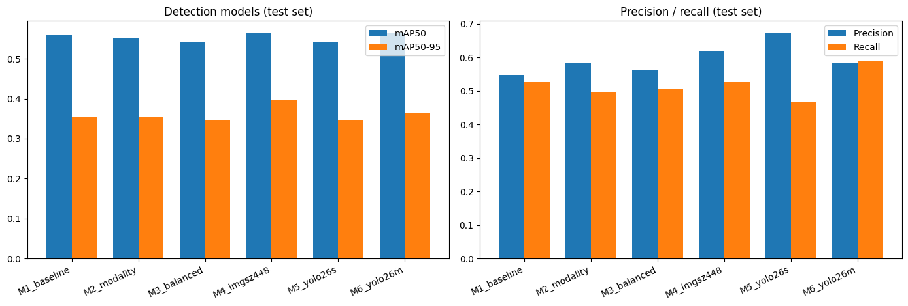
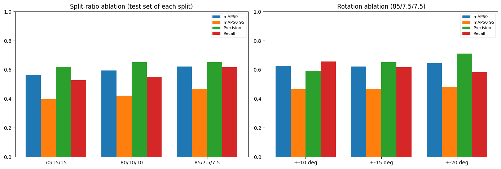
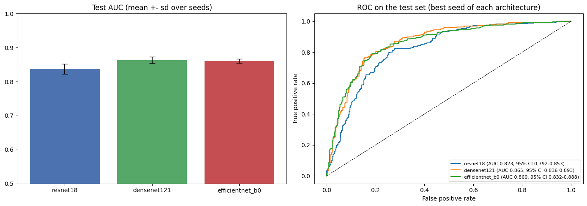
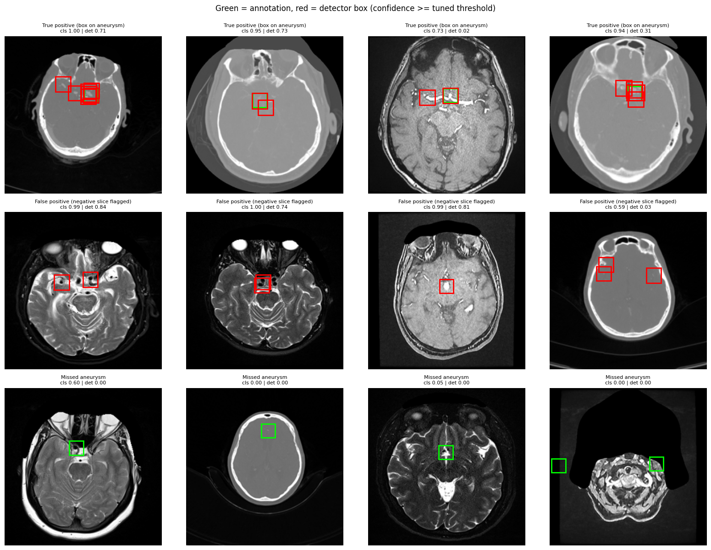
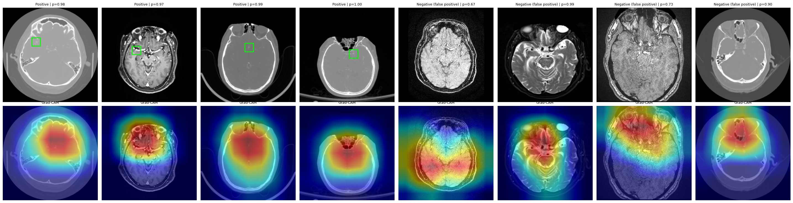
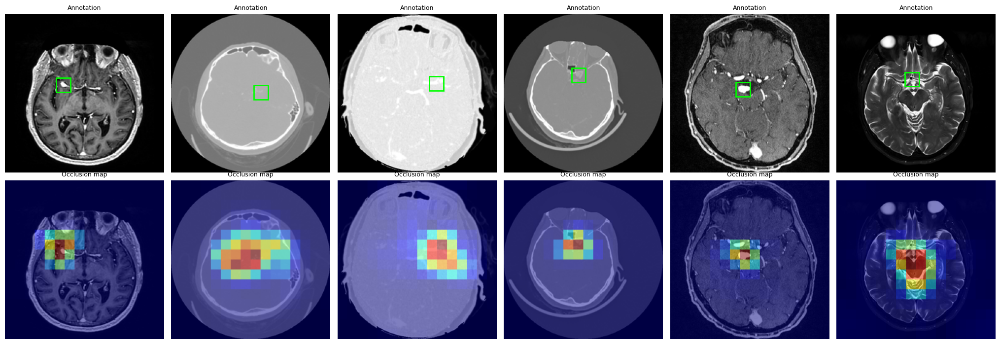

# Intracranial Aneurysm Classification and Detection on Multimodal Brain Imaging Using Hybrid Approach

B.Sc. thesis project, Department of Computer Science and Engineering,
Port City International University (PCIU), Chattogram, Bangladesh.

- **Authors:** Alok Roy, Fahamida Amin Tonni
- **Supervisor:** Zarin Rafah Chowdhury, Lecturer, Dept. of CSE, PCIU

## About the project

A brain aneurysm is a weak, bulging spot in a brain artery. Finding small aneurysms on scans takes time, and they are easy to miss. In this project we built a system that looks at 2D brain scan slices and does two things:

1. **Classification:** is there an aneurysm in this slice or not?
2. **Detection:** if yes, where is it? It draws a box around it.

We use four imaging types (modalities) together in one model: **CTA, MRA, MRI T1post and MRI T2**. The model also knows which modality each image comes from. We then join the best classifier and the best detector into one **hybrid** pipeline. Finally, we use explainability maps (Grad-CAM and occlusion) to check where the models are looking.

## Repository structure

```
.
├── notebooks/
│   ├── 01_data_pipeline.ipynb               # DICOM -> PNG, boxes, 3 splits, dataset figures
│   ├── 01b_preprocessing_figure.ipynb       # before/after preprocessing figure
│   ├── 02_detection_models.ipynb            # 6 YOLO26 detectors (M1-M6) compared
│   ├── 03_split_and_rotation_ablation.ipynb # split-ratio and rotation-degree ablations
│   └── 04_classifier_hybrid_xai.ipynb       # 3 classifiers, hybrid pipeline, Grad-CAM, occlusion
├── src/
│   └── common.py                            # shared helpers used by notebooks 02, 03 and 04
├── figures/                                 # all figures, taken from the notebook outputs
├── requirements.txt
└── README.md
```

Every notebook keeps its outputs, so you can read all results on GitHub without running anything. Notebooks 02, 03 and 04 also contain a copy of `src/common.py` in their "Shared helpers" cell, so each one runs on its own in Kaggle.

## Workflow



## Dataset

We used two Kaggle sources. The data is not stored in this repository.

- [RSNA Intracranial Aneurysm Detection](https://www.kaggle.com/competitions/rsna-intracranial-aneurysm-detection) (competition data, raw DICOM)
- [RSNA 2025 Intracranial Aneurysm PNG 224x224](https://www.kaggle.com/datasets/dennisfong/rsna-2025-intracranial-aneurysm-png-224x224) (series index and localizer points)

How we prepared the data (notebook 01):

- Every image, positive and negative, goes through the same steps: raw DICOM → 1st–99th percentile window → 8-bit → resized to 224×224.
- The dataset only gives a point for each aneurysm, not a mask. So we draw a fixed **20×20 px box** around each point.
- For positive series we use the actual annotated slice. Multi-frame positive series (142) are left out because they have no frame-level location.
- Splits are made at the **series level** (no series appears in two parts) and are stratified by modality + label.

| | Count |
|---|---|
| Series | 4,023 (1,718 with aneurysm, 2,305 without) |
| Images | 4,372 |
| Aneurysm boxes | 2,106 |

| Split | Train images | Val images | Test images | Test boxes |
|---|---|---|---|---|
| 70/15/15 (main) | 3,050 | 648 | 674 | 332 |
| 80/10/10 | 3,476 | 439 | 457 | 229 |
| 85/7.5/7.5 | 3,712 | 322 | 338 | 170 |

## Methods in short

**Modality-aware input.** Each image is turned into 3 channels: grayscale, grayscale, and a constant channel that tells the modality (CTA = 0, MRA = 85, MRI T1post = 170, MRI T2 = 255).

**Balanced training.** The training set is oversampled so that all four modalities have the same number of images.

**Augmentation (train only).** Horizontal flip and rotation (±15° by default). Colour jitter is turned off so the modality channel stays correct.

**Detectors (notebook 02).** YOLO26 (Ultralytics), 50 epochs, batch 32, patience 15, seed 42, image size 224 unless noted.

| Model | What changes |
|---|---|
| M1 Baseline | YOLO26n, plain grayscale, unbalanced |
| M2 Modality-aware | + modality channel |
| M3 Balanced | + modality balancing |
| M4 Balanced + 448 px | M3 with 448×448 input |
| M5 YOLO26s | M3 with the small model |
| M6 YOLO26m | M3 with the medium model |

**Classifiers (notebook 04).** ResNet18, DenseNet121 and EfficientNet-B0 (ImageNet weights), 20 epochs, Adam (lr 1e-4), batch 32, 3 seeds each.

**Model choice.** The best detector and the best classifier are always picked by **validation** score, never by test score. The test set is used only once, at the end.

## Results

### 1. Detection models (70/15/15 split, test set)

| Model | mAP50 | mAP50-95 | Precision | Recall | F1 | Val mAP50 |
|---|---|---|---|---|---|---|
| M1 Baseline | 0.559 | 0.356 | 0.549 | 0.527 | 0.538 | 0.576 |
| M2 Modality-aware | 0.553 | 0.353 | 0.584 | 0.497 | 0.537 | 0.595 |
| M3 Balanced | 0.541 | 0.345 | 0.563 | 0.506 | 0.533 | 0.543 |
| **M4 Balanced + 448 px** | **0.566** | **0.397** | 0.618 | 0.527 | 0.569 | **0.649** |
| M5 YOLO26s | 0.541 | 0.346 | 0.675 | 0.467 | 0.552 | 0.590 |
| M6 YOLO26m | 0.564 | 0.364 | 0.584 | 0.588 | 0.586 | 0.563 |

M4 had the highest validation mAP50, so it is the detector used in the ablations and in the hybrid model.

### 2. Split-ratio and rotation ablations (M4, test set of each split)

| Split (rotation ±15°) | mAP50 | mAP50-95 | Precision | Recall | F1 |
|---|---|---|---|---|---|
| 70/15/15 | 0.566 | 0.397 | 0.618 | 0.527 | 0.569 |
| 80/10/10 | 0.594 | 0.421 | 0.652 | 0.550 | 0.597 |
| 85/7.5/7.5 | 0.622 | 0.469 | 0.652 | 0.617 | 0.634 |

| Rotation (85/7.5/7.5 split) | mAP50 | mAP50-95 | Precision | Recall | F1 |
|---|---|---|---|---|---|
| ±10° | 0.628 | 0.466 | 0.592 | 0.657 | 0.623 |
| ±15° | 0.622 | 0.469 | 0.652 | 0.617 | 0.634 |
| ±20° | 0.645 | 0.482 | 0.712 | 0.583 | 0.641 |

### 3. Classifiers (70/15/15 split, mean ± sd over 3 seeds)

| Model | Val AUC | Test AUC | Accuracy | Precision | Recall | Specificity | F1 |
|---|---|---|---|---|---|---|---|
| ResNet18 | 0.868 ± 0.007 | 0.837 ± 0.015 | 0.757 ± 0.022 | 0.725 ± 0.039 | 0.807 ± 0.027 | 0.709 ± 0.067 | 0.763 ± 0.011 |
| **DenseNet121** | **0.883 ± 0.001** | **0.863 ± 0.010** | 0.792 ± 0.008 | 0.772 ± 0.015 | 0.810 ± 0.005 | 0.774 ± 0.021 | 0.791 ± 0.005 |
| EfficientNet-B0 | 0.866 ± 0.006 | 0.861 ± 0.006 | 0.785 ± 0.011 | 0.747 ± 0.016 | 0.843 ± 0.005 | 0.730 ± 0.023 | 0.792 ± 0.008 |

DenseNet121 had the best validation AUC and was selected. Its 3-seed ensemble with flip reached a test AUC of 0.877.

### 4. Hybrid model (test set; thresholds set on validation)

| Mode | Accuracy | Precision | Recall | F1 |
|---|---|---|---|---|
| A: DenseNet121 only | 0.804 | 0.786 | 0.820 | 0.802 |
| B: M4 detector only | 0.823 | 0.799 | 0.850 | 0.824 |
| **C: Classifier AND detector (hybrid)** | **0.835** | **0.825** | 0.838 | **0.832** |

The hybrid (mode C) gives the best accuracy, precision and F1, with fewer false positives (58) than either model alone (73 and 70). Image-level AUC: classifier 0.877, detector 0.890, combined score 0.897.

Classifier AUC per modality (test set):

| Modality | Test images | Positives | Classifier AUC |
|---|---|---|---|
| CTA | 318 | 192 | 0.911 |
| MRA | 183 | 90 | 0.765 |
| MRI T1post | 48 | 14 | 0.811 |
| MRI T2 | 125 | 31 | 0.841 |

The notebook also reports a stricter check where the predicted box must overlap the real aneurysm (IoU ≥ 0.5 or ≥ 0.3). Those numbers are lower (F1 0.72–0.73).

### 5. Explainability

| Method | Images | Heat inside the aneurysm box | Expected by chance | Peak inside the box |
|---|---|---|---|---|
| Grad-CAM (classifier) | 327 | 6.6% | 2.4% | 32.4% of images |
| Occlusion (detector) | 60 | 42.3% | 2.4% | 86.7% of images |

Both models focus on the aneurysm region far more than chance (p < 0.01). The detector's attention is much sharper than the classifier's. Compared with a centre-position prior (the mean Grad-CAM map), the detector's occlusion maps stay well ahead (42.3% vs 18.3%). The classifier's Grad-CAM is close to the prior on average (6.6% vs 6.6%), but higher than it in 64% of images.

## Figures

| | |
|---|---|
|  |  |
| Dataset overview | Preprocessing: before vs after |
|  |  |
| Detection models (test set) | Split and rotation ablations |
|  |  |
| Classifier comparison | Hybrid examples |
|  |  |
| Grad-CAM (classifier) | Occlusion maps (detector) |

More figures (age/sex, location, sample images, training curves) are in the [figures](figures/) folder.

## How to run

All notebooks were made for **Kaggle**. They read from `/kaggle/input` and write to `/kaggle/working`.

1. In Kaggle, create a new notebook and import the `.ipynb` file from this repository.
2. Add the two datasets listed above as inputs.
3. Run the notebooks in this order. When a notebook needs an earlier one, add that notebook's output as input (**Add Input → Your Work → Notebook output**).

| Notebook | Needs | Accelerator |
|---|---|---|
| 01_data_pipeline | the two datasets | CPU is enough |
| 01b_preprocessing_figure | datasets + output of 01 | CPU |
| 02_detection_models | output of 01 | GPU T4 |
| 03_split_and_rotation_ablation | outputs of 01 and 02 | GPU T4 |
| 04_classifier_hybrid_xai | outputs of 01 and 02 | GPU T4 |

Use **Save & Run All (commit)** for the GPU notebooks so training keeps going if the browser disconnects. Notebooks 02, 03 and 04 save results after each run. If a session stops, add its output as input and run again, and finished runs are skipped.

## Acknowledgements

We thank our supervisor, Zarin Rafah Chowdhury, for her guidance. We also thank RSNA and the Kaggle community for the dataset.
